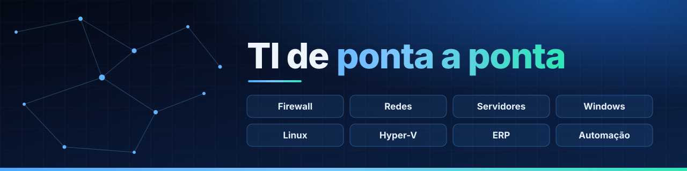

## Olá, eu sou o Leonardo 👨🏻‍💻

**Analista de TI** em Itatiba-SP. Cuido da operação de TI de ponta a ponta: servidores, rede, segurança, Microsoft 365, ERP TOTVS Protheus, service desk e automação.

Venho da logística e da produção industrial, então olho para a TI como ferramenta de negócio: **encontrar o gargalo, medir e automatizar**.

### 🧰 Áreas e tecnologias

**Infraestrutura** 

**Segurança e Microsoft 365** 

**ERP, service desk e monitoramento** 

**Automação e dados** 

**Desenvolvimento e estudos** 

  
  
  
  
  
  
  
  

### 🚀 Destaques

- Assistente de IA corporativo em produção, integrado aos dados do ERP
- Pipeline de dados do Protheus reescrito em Python, com o tempo de processamento reduzido pela metade
- Implementação do GLPI 11 em todos os departamentos
- Apps em Power Platform para campo, recebimento e RH

### 📊 GitHub

  

### 📫 Onde me encontrar

